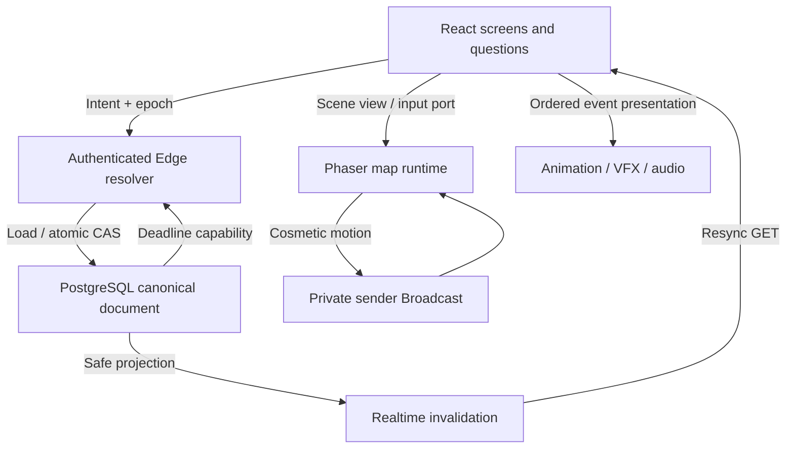

# NOVA ZENITH — Extra High3 final audit
Date: 21 October 2026 (Asia/Jakarta). This is a bounded technical audit with fixes, not a claim that every environment or human acceptance gate was tested.

# Executive Summary
Final recommendation: **NOT RELEASE READY** for broad public launch until the human guest/mobile and balance gates below are demonstrated. The implemented game and authoritative engine are testable; no observed damage-authority/desync defect remains in completed scenarios. A real production boot/configuration blocker and two exit-flow defects were reproduced and fixed. Final deployed verification and fresh four-player evidence are recorded below.

# Repository Baseline
Inspected `ed3a6472b9e9d9d5a3dfdaee58b1caaeb07f84c0` from Xpurple27/Project-Nova-Zent. Re-cloned after workspace maintenance; did not rely on the old scratch installation. Read blueprint, multiplayer architecture/ExtraHigh2 history, verification/High6–13 evidence, Art Bible, Sprite Pipeline, exploration/story, audio, question spec/QA, migrations, runtime reducers/adapters/UI and tests. Canonical art reference is repository docs/ART_BIBLE.md. No Stage2/content-system expansion was added.

# Architecture Findings

| Runtime segment | Authority and recovery |
|---|---|
| Landing → guest → lobby/classes/Ready | Supabase Auth guest identity, SQL membership/classes/capacity/Start locks; tab storage is a credential/checkpoint cache |
| Start → opening → Village/paths | One campaign-enabled root session; server story timing/skip votes and scene-token/rally agreement |
| Hound → world → Shaman → world | Same deterministic combat/reaction reducer, sequential completion gates, frozen roster scaling and recovery |
| Ruins → entrance → Guardian | Same story finalization/startEncounter CAS; no Phaser combat or host authority |
| Planning → Math → resolution → boss → reaction/Rune → turn end | Immutable turn/phase UUIDs, DB clock, per-assignment deadlines, row lock/CAS/receipts, recorded RNG/intent |
| Victory → ending → COMPLETED / Defeat → back | Terminal server outcome; room pointer cleared on user exit, Auth retained |

Persistent orchestration states: STORY, EXPLORATION, COMBAT_PLANNING, MATH_CHALLENGE, COMBAT_RESOLUTION, BOSS_ACTION, DEFENSIVE_REACTION, TEAM_RUNE, TURN_END, SUSPENDED, VICTORY, DEFEAT, ENDING, COMPLETED, ABORTED. SQL maps TEAM_RUNE to MATH_CHALLENGE + context. Product TURN_START/LOCK_ACTION and encounter initialization are atomic internal boundaries rather than separate waits. `engine.phase` is the nested combat reducer state; it is not a second browser authority. `core/fsm.ts` is the conceptual product graph, while server/authority + campaign implement persisted transitions. Documentation now distinguishes these layers.

The relational combatants/actions/assignments/events are audit mirrors; canonical effects remain in combat_json. React/Phaser caches do not calculate HP/outcomes. Reconnect uses a safe scene spawn, immutable assignment/deadline and the latest snapshot, not replay of a whole run. Per-sender movement is cosmetic client authority; shared gate order/party agreement is server authority, not proof of pixel proximity.

# Critical Findings
| Issue | Root cause / reproduction | Fix | Regression / status |
|---|---|---|---|
| C-01 Production guest entry blocked | Real Vercel `/lobby` returned Unavailable / SUPABASE_NOT_CONFIGURED. Vercel had unprefixed SUPABASE_PUBLISHABLE_KEY / HCAPTCHA_SITE_KEY and legacy ANON_KEY; frontend expected NEXT_PUBLIC names | Added the two exact public production env names; Vercel production build now rejects missing configuration or a non-publishable browser key | Environment guard test; final deployed guest-form check recorded below. No secrets decrypted or exposed |

# High Findings
| Issue | Root cause | Fix | Regression / status |
|---|---|---|---|
| H-01 Ending traps the next expedition | COMPLETED Return home retained nz.room.v1, so returning to lobby restored the completed game | Clear only saved room pointer on ending exit; retain guest Auth | Browser test failed on baseline, passes after fix |
| H-02 Permanent leave did not exit | Server departed state was recorded but UI retained old combat and saved room | After accepted LEAVE, clear room pointer and navigate home; failed transport does not discard membership | Browser test failed on baseline, passes after fix |

# Medium Findings
| Issue | Fix / decision | Status |
|---|---|---|
| M-01 Presentation backlog on background/resume | Bound queue to latest12 events (≤2.16s), discard while hidden and rebase cursor on visibility change; snapshot remains immediate | Fixed; pure regression + browser presentation/audio checks |
| M-02 Unbounded body read / accidental command bursts | Stream body limit8KiB, per-isolate authenticated budget40/10s with bounded2048 entries; 413/429 responses | Fixed baseline guard; broader global/IP/rejected-lobby protection remains OPEN |
| M-03 Balance target outliers | Do not silently alter frozen stats/formulas. Measure policy/composition results below and require human validation/tuning decision | OPEN |
| M-04 Fresh backend reproducibility | 13 migrations match live DB; document exact private export and environment-specific watchdog setup | Fresh isolated migration replay NOT TESTED (no disposable Postgres/Supabase instance available) |

# Low Findings
- Historical ExtraHigh2 docs still described disabled guest Auth/pilot bank as current; labeled historical and updated current architecture/content references.
- CI had write contents permission and a lockfile auto-commit step despite committed lockfile. Removed mutation step, reduced to read-only, pinned checkout/setup-node to explicit upstream commits. Pinned esbuild version with its lockfile.
- Existing pg_net metadata namespace advisor remains. Default-deny private RLS tables and membership-bound anonymous policies are intentional; cron policies are username=CURRENT_USER, not an unrestricted job listing.
- General stale room/session archival and unused server-only Vercel service-role configuration remain operations follow-ups. No frontend service key was found; no rotation is claimed or necessary based solely on these scans.

# Multiplayer Verification
- Existing 1P/2P/4P full server simulations retained; duplicate actions/answers/Ultimate/resolvers, grace/reconnect, canonical snapshots and terminal replay regressions pass.
- New live browser/API probe: fifth join denied; simultaneous Mage claim has one winner; duplicate Start returns one session; outsider snapshot/projection denied; direct projection/player edits and backend commit/bank/import RPC calls return403. Ten assertions passed. Probe session `f6d9c35d-dea0-4918-bc8f-cf5fd605494c`.
- New full live 1P and 4P campaign evidence appears under UAT. 2P full campaign is simulated, not a newly completed two-device human run.
- Snapshots are version/epoch fenced. Independent same-phase input may use an older observed version; future version/old turn/old phase rejects. Identical retry receipts can be old versions and are ignored by monotonic presentation. Durable state, not Broadcast arrival, repairs gaps.

# Exploration Verification
Five scenes, collision/map bounds, normalized frame-independent movement, touch/keyboard, camera and per-seat checkpoint spawn inspected. Private sender identity RLS denies impersonation/outsiders. No per-frame DB coordinate writes; moving packets≤10Hz, idle1Hz. Remote interpolation keeps≤8 frames, hides missing packets after5s and fences old streams/scene tokens. Scene/route cleanup removes renderer/channels/listeners. Browser mount/unmount, two-tab QA transport, missing sprite, touch and rotation pass. Live four-context private movement is separately verified, not inferred from BroadcastChannel tests.

# Story/Cutscene Verification
Server-owned opening48s, encounter hooks4s, entrance12s and ending14s; all active grace-roster members must vote skip. Natural expiry/skip share final mutations. Reconnect seeks current logical time without old SFX; control locks are view-derived. Tests cover unanimous skip, grace expiry, safe end state and entrance title. Short timelines can naturally complete while a late skip request is in flight; harness treats a vanished/disabled optional skip button as a completed input opportunity, not a logical softlock.

# Enemy Verification
Hound and Shaman reuse engine/mitigation/reaction/grading. Definitions/scaling/cycle/effects and 1–4P tests pass. Hound teaches single/react; Shaman exposes AoE and delayed two-round chant effects. Strong parties can defeat Shaman before its utility action; that is not evidence the utility is unimplemented. Full HP, resource40, Ultimate≤50 recovery, cleared effects and durable completion flags are server-only. Refresh changes none of these.

# Abyss Guardian Verification
Added exact60.1/60/59.9/25.1/25/24.9 boundary vectors, large jump61→20 behavior,10,000 weighted threat selections, inactive/KO exclusion, all reaction tiers, multiplicative mitigation,1–4P Rune thresholds, same-round Core death/retarget once, and Rage100 boss-death precedence. Existing skill/Ultimate/synergy/KO/revive/phase/heavy cooldown tests retained. No formula or class stat was changed. Charge gives a full next player input phase before Cataclysm; no post-death attack is permitted.

# Reconnect / AFK Verification
Main/reaction/Rune input owns an immutable deadline. Missing planning defaults to basic, missing Math/reaction fails, Rune freezes participants/threshold. Disconnect never rerolls a recorded target. Grace expiry skips later actors; all absent suspends/aborts instead of waiting forever. Existing simulation tests cover input phases and suspension; live runs include scene checkpoint reload, combat refresh, reaction disconnect and stale/late input. Not every phase was separately exercised on a physical device; see limitations/checklist.

# Security Audit
- Three exposed application tables have RLS; authenticated has SELECT only. Private grading/state tables and load/commit/bank/import RPCs deny normal clients.
- Safe own-assignment DTO omits correctToken/question revision/selected token/explanation. Public projection scan found zero private-key marker hits. Client-supplied correctness/performance/damage fields are stripped by parser.
- Server Auth getUser verifies identity before load; capability worker validates short-lived SQL job token. Existing gateway verify_jwt=false is paired with this in-handler validation, not anonymous combat authority.
- Tracked-source literal scan found no JWT service secret or sb_secret key. Vercel env metadata inspected without decrypting secrets. Public Supabase publishable/site keys are intentionally public; no service key belongs in NEXT_PUBLIC vars.
- Advisor: [pg_net namespace](https://supabase.com/docs/guides/database/database-linter?lint=0014_extension_in_public); [anonymous policy review](https://supabase.com/docs/guides/database/database-advisors?queryGroups=lint&lint=0012_auth_allow_anonymous_sign_ins). No extension relocation or Auth configuration weakening was performed.

# Mobile Audit
23 Chromium browser tests pass: widths320/360/375/390/412 and1280, long formulas/options, skill controls, dialogue/telegraphs, audio and touch. Touch CDP injection moves the actor after scrolling the control into view; portrait→landscape→portrait retains the world. A failed sprite load does not crash movement. These are emulated browser tests. Physical Android Chrome, physical iOS/Safari and adverse real mobile networks: **NOT TESTED**.

# Question Bank Audit
120 reviewed ACTIVE production-v1 items,40 per difficulty;14 categories. Affinity counts overlap: Warrior55/Mage35/Thief26/Healer40. Zero exact normalized prompt duplicates;120 template-family labels. Structural validator and restricted-AST exact rational checks pass for all120: exactly four distinct numeric choices and exactly one matching official key; derivations compared to stored independent rational values. All prompt categories, including Hard word problems, were inspected. This is agent/editorial + programmatic QA, not independent teacher/psychometric review. Estimated7/12/19s burden fits12/18/25s limits on paper; actual learner solving-time suitability: **NOT TESTED**.

Server category affinity preference/fresh run history/fallback/per-phase distinctness are retained. Retired pilot answers in public Git are not served online. A fresh bank must be imported privately; empty difficulty pools fail closed rather than silently serving public development answers.

# Performance Audit
- Static JS emitted: approximately2.20MB raw across all chunks, including lazy Phaser; this is not initial compressed download size. Largest SVG sheet34,393 bytes; no huge PNG/audio bundle. Four character exploration textures fit the documented budget; Guardian chamber texture adds its own allocation.
- Packet rate/frames/voice caps inspected; no per-frame SQL writes or unbounded emitter/voice queue. Effect lifetime≤1100ms; audio≤12 voices; presentation≤12 events after hardening.
- Watchdog/cleanup active; observed839 recent cron runs succeeded at inspection.48 application/private indexes present, including membership, CAS/session, receipts and assignment/event uniqueness. No load or traffic-billing capacity claim is made.
- Local headless map sample measured122 RAF frames over2016.6ms (~60fps), one canvas and14 loaded resources. Baseline production FCP was16.948s through the runner proxy and its guest form was broken; this proxy observation is not an Android load-time measurement. Emulated FPS is not consumer Android certification. Network stress/soak/heap profiling on physical hardware: **NOT TESTED**.

# Test Results
| Check | Result |
|---|---|
| npm ci; lockfile validation | PASS |
| npm audit --omit=dev | 0 vulnerabilities reported |
| npm run typecheck | PASS |
| npm run lint | PASS, zero warnings |
| npm test | 80 PASS, all original tests retained |
| npm run check:edge | PASS |
| SQL lobby.sql / combat.sql / exploration.sql | All3 PASS, rolled-back fixtures |
| Production build | PASS, Vercel-production environment validation enabled |
| Browser E2E | 23/23 PASS on final source / successful production build (15.0s) |
| Private content validation + arithmetic QA | 120/120 PASS |
| Live API security/concurrency probe | 10 assertions PASS |
| Offline balance sweep | 1,350 seeded boss fights,15 nonempty unique-class compositions ×3 profiles ×30 seeds |

# UAT Results
Solo session `10e4ccbb-be35-468e-b3dd-74a4263c3c72`: full opening/world/Hound/Shaman/Guardian/ending reached COMPLETED, duration413.418s, Guardian12 rounds, final global turn17,170 observed events, no browser page errors. Included deliberate refresh/offline recovery and stale-turn rejection; four-person strings in legacy harness output are labels only, not evidence of four solo clients. Uses one temporary confirmed QA Auth identity, not a human CAPTCHA-created anonymous guest. Instant scripted answers/skips mean this is not human run-duration evidence.

Fresh four-player session `002914fd-0514-428f-82e4-b37b66ebce0d`: full campaign completed without DB state repair or harness resume. Harness elapsed393.267s including lobby; DB start→finish352.098729s. Guardian8 rounds; final global turn12. All four canonical final snapshots matched and UIs reached ending. All scenes rendered3 remote teammates via actual private channels.201 safe question payload observations, no page errors, one intentional Math timeout, late-answer rejection, combat refresh and reaction disconnect/reconnect preserving assignment/deadline. Database:302 events; zero duplicate ACTION_RESOLVED actor/turn groups; ENEMY_DEFEATED2, BOSS_DEFEATED1, ENCOUNTER_COMPLETED3, CUTSCENE_COMPLETED5, phase transitions2, Barrier creation/break1, Core spawn/destruction1, Cataclysm1. Three VICTORY events are one per encounter, not duplicate boss Victory. Solo DB start→finish390.433184s,170 events and zero duplicate action groups.

 Earlier attempts stopped due harness timing: class-selection response not awaited before Ready, and attempting to click optional Skip after a4s cutscene naturally ended. Harness corrected, then a new room was started; no game-state DB repair was used to continue a golden path. Failed attempt histories will remain explicitly distinguishable from the final fresh run.

# Balance Results
Reference policy uses burst/Expose/healing/Ultimates/Core protection; it is not an optimal strategy or human player model. All450 SUCCESS and450 PERFECT fights won;443/450 MIXED fights won (20% wrong with some Perfect). SUCCESS round range8–24; PERFECT5–13; MIXED6–32. Full4P SUCCESS policy averaged8 rounds. Solo Warrior14 and solo Healer24 under this support-heavy policy miss the6–10 target; Warrior+Healer15. All supported solo classes can win, but policy outliers and failure survivability require a measured tuning/playtest pass before broad release. No silent resonance/class rebalance was introduced in a correctness audit. Additional frozen-contract tradeoff: solo Warrior basic Perfect deals250 to the350HP Core; solo Healer basic Perfect with its maximum Blessing deals300. Those classes cannot destroy that Core within the one-action exposure window and instead use the documented protection/recovery counterplay. Core destruction is optional, and the full solo campaign can win, but if every solo class must be able to destroy Core, a deliberate balance-contract change is required before release; do not claim universal solo Core-break coverage.

# Known Limitations
Human hCaptcha acceptance and fresh anonymous deployed golden paths are not established by synthetic Auth fixtures. Physical mobile/Safari/network diversity, fresh isolated migration replay, broad load/soak, student timing and human balance remain NOT TESTED. Art/music remain original replaceable placeholders allowed by MVP scope. No spatial anti-cheat, account recovery across lost anonymous storage, final art production, Stage2 or progression was added.

# Quality Gate Matrix
| Gate | Result | Scope / remaining evidence |
|---|---|---|
| A Build/static | PASS | Typecheck/lint80 tests/production build/Edge drift |
| B Migrations | PARTIAL |13 live migration versions match,3 SQL suites pass; fresh disposable replay NOT TESTED |
| C Auth/lobby | PARTIAL | Race/capacity/Ready/Start/RLS pass; production public env fixed, deployed guest verification below; human CAPTCHA NOT TESTED |
| D Authoritative multiplayer | PASS | Shared engine, CAS/receipts/deadlines, live302-event4P audit, no duplicate action groups |
| E Exploration | PASS | Private4P motion, collision, cleanup, checkpoint recovery; cosmetic authority explicitly limited |
| F Story | PASS | Logical expiry/skip/control/ending; no video or host authority |
| G Normal encounters | PASS | Shared engine1–4P tests and full live solo/4P flow |
| H Boss | PASS | Boundaries/synergies/reactions/Heavy/Rune/Core/phase and terminal tests + live4P mechanics |
| I Reconnect/AFK | PASS in tested scope | Simulated input cases and selected real disconnect/refresh/timeouts; full physical phase matrix NOT TESTED |
| J Question privacy | PASS | Private bank grants, safe payloads and bundle scan; no official key mismatch in120 checks |
| K Mobile | PARTIAL | Six widths, touch and rotation pass; physical Android/iOS NOT TESTED |
| L Security/RLS | PASS in tested scope | Privileged mutation/key access denied; budget is not broad global/IP protection |
| M Performance | PARTIAL | Headless60fps/asset/traffic bounds measured; consumer-device/load/soak NOT TESTED |
| N Golden4P | PARTIAL | Complete fresh-room4-context synthetic-Auth run passes; fresh human guest/deployed smartphone chain NOT TESTED |

# QA teardown
Five confirmed synthetic Auth identities were created only through a short-lived capability-guarded Admin helper; hCaptcha/anonymous provider settings were not weakened. All five deleted; SQL verifies zero remain. Six QA rooms expired; three unfinished QA sessions aborted during teardown only, after all measured runs/probes ended. Completed1P/4P outcomes and event audits retained. Bootstrap capability expired; nova-release-qa now version2 only returns410 and gateway JWT verification is enabled. Local credential fixture overwritten. No QA provisioning endpoint or private bank export is committed.

# Release Blockers
1. Demonstrate fresh human hCaptcha/anonymous sign-in and the full deployed smartphone flow, after the configuration fix is deployed.
2. Execute the physical Android/desktop 1P/4P checklist with recorded devices/networks; do not substitute local emulation/synthetic users for that gate.
3. Review support-heavy balance/timer outliers with actual learners; verify the intended run/round expectations before broad school/public invitations.
4. Verify the final commit deployment and repeat the fresh-guest entry check after the public environment correction; do not infer a deployed pass from a local build.

# Final Recommendation
**NOT RELEASE READY** for broad public launch under the prompt's fresh-human-smartphone definition. Fixed code is suitable for continued controlled acceptance testing. Do not proceed to Stage2 or claim release certification from automated engine/browser evidence alone.

# Changed files and deployment boundary
Changes are confined to ending/leave exit, bounded presentation/canonical comparison, Edge HTTP guard, production env validation, read-only pinned CI, tests/audit harnesses and documentation. Existing combat formulas/stats,13 SQL migrations, active bank content and campaign order are unchanged. nova-combat version7 ACTIVE uses the checked generated resolver bundle. This audit adds no permanent database migration. Vercel production received only the two intended PUBLIC variable names; existing secret values were never decrypted.
